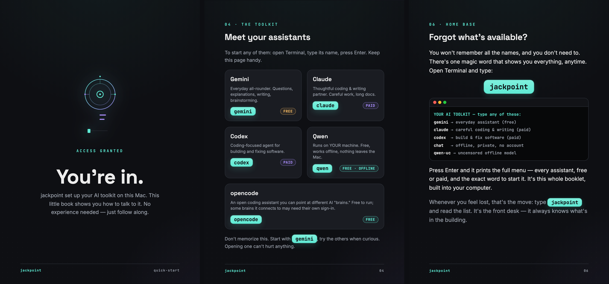

# jackpoint: install Claude Code, Gemini CLI and Codex on a Mac

One command installs every AI coding CLI on your Mac: Claude Code, Gemini CLI, OpenAI Codex CLI, qwen-code, opencode, and an optional offline model. It is written for people who have never opened a terminal.



## Quick start

Open Terminal (Command+Space, type "Terminal", press Enter), paste this line and press Enter:

```sh
curl -fsSL https://raw.githubusercontent.com/DareDev256/jackpoint/main/install.sh | bash
```

It installs Node (only if a tool needs it) and every CLI below. Re-running is safe: it skips what's already there and retries what failed. Prefer to look first? [Read the script before you pipe it to bash](#read-the-script-before-you-pipe-it-to-bash).

macOS only. License: MIT, see [LICENSE](LICENSE).

## What you get

- **Claude Code** — Anthropic's CLI. Needs a Claude Pro/Max account.
- **Gemini CLI** — Google's CLI with a genuinely usable free tier. The best place to start if you've never done this before.
- **OpenAI Codex CLI** — OpenAI's coding agent. Needs a paid ChatGPT plan or API key.
- **qwen-code** — Alibaba's open coding CLI. Use a provider key, or run it on your local model with `--local`.
- **opencode** — open-source, model-agnostic CLI. Point it at any provider, your Claude Pro login, or a local model.
- **The `jackpoint` command** — type it any time to see your cheatsheet: what's installed and how to launch each tool.

Each tool is independent. You don't need accounts for all of them. Set up the one you want and ignore the rest.

## Flags

Add a flag to the end of the install line.

```sh
# Also install a local model that runs offline on your Mac (via Ollama).
curl -fsSL https://raw.githubusercontent.com/DareDev256/jackpoint/main/install.sh | bash -s -- --local

# Use an uncensored (abliterated) local model. Implies --local. Local only, never sent anywhere.
curl -fsSL https://raw.githubusercontent.com/DareDev256/jackpoint/main/install.sh | bash -s -- --uncensored

# Lightweight path: just Gemini (free) + Claude Code.
curl -fsSL https://raw.githubusercontent.com/DareDev256/jackpoint/main/install.sh | bash -s -- --minimal
```

- `--local` — installs Ollama plus a coding model sized to your Mac's RAM. Runs on your machine, works with no internet, no account, no API key. Slower than the cloud tools and needs a few GB of disk and RAM.
- `--uncensored` — uses an abliterated local model with the refusal behavior removed, for when the default model refuses reasonable requests. Local only. Implies `--local`. No guardrails means it's your responsibility.
- `--minimal` — skips the heavier tools. Good for an older Mac or someone who just wants one easy thing.

## First commands

Open Terminal (Command+Space, type "Terminal", Enter) and try these.

```sh
jackpoint        # show your cheatsheet any time you forget a command
gemini           # start here — free tier, walks you through sign-in
```

`gemini` is the easiest start. It opens a chat, prompts you to sign in with a Google account on first run, and the free tier is enough to actually learn on. Ask it to explain a file, write a script, or fix an error.

Once you're comfortable:

```sh
claude           # Claude Code (needs Claude Pro/Max)
codex            # OpenAI Codex CLI
opencode         # model-agnostic CLI
```

If you installed a local model:

```sh
chat             # talk to the offline model — no internet, no account
qwen-uc          # the uncensored local model (only if you used --uncensored)
models           # list your local models
```

To leave any of these, type `/exit` or press Control+C.

## Not for you if

- **You're on Windows or Linux.** This installer is macOS only. The CLIs themselves run elsewhere; this script doesn't.
- **You want zero setup.** Most of these tools need you to sign in or paste an API key the first time. jackpoint installs them and tells you how to start each; it can't create accounts for you.
- **You expect the local model to match the cloud ones.** `--local` is real and private, but a model on your laptop is slower and less capable than Claude or Gemini. It's a fallback and a privacy option, not a replacement.
- **You need pinned versions or a custom toolchain.** This installs current stable releases with sensible defaults.

## Read the script before you pipe it to bash

Piping a URL straight into `bash` runs whatever that URL serves with your permissions. That's fine when you trust the source, but never do it blindly. Read it first — open https://github.com/DareDev256/jackpoint/blob/main/install.sh, or download, read, then run it locally:

```sh
curl -fsSL https://raw.githubusercontent.com/DareDev256/jackpoint/main/install.sh -o jackpoint-install.sh
less jackpoint-install.sh        # read it (press q to quit)
bash jackpoint-install.sh        # run it once you're satisfied
```

The script is short and commented for exactly this reason.

## Troubleshooting

**`curl: (6) Could not resolve host`** — DNS isn't resolving. Point at a public resolver, then re-run:

```sh
networksetup -setdnsservers Wi-Fi 1.1.1.1 8.8.8.8
sudo dscacheutil -flushcache; sudo killall -HUP mDNSResponder
```

**Something failed partway through.** Run the install line again. jackpoint skips what's already installed and retries only what failed — re-running is the fix, not a reset.

**Want to see why something failed.** Every run writes a full log to `~/.jackpoint.log`. Open it with `less ~/.jackpoint.log` (press `q` to quit), or paste the tail into an issue.

**A command isn't found after install.** Close and reopen Terminal (or open a new tab) so it picks up the new PATH, then try again.

## How it works

`install.sh` checks for the tools you asked for, installs Node only if Gemini or qwen-code need it (to a user-writable npm prefix so there's no `sudo` and no permission errors), installs each CLI through its official method, wires up your PATH and the `jackpoint` cheatsheet, and logs everything to `~/.jackpoint.log`. Native installers go to `~/.local/bin`; npm tools go to `~/.npm-global`.

## Guides

Three designed guides ship with jackpoint. Read them in the browser, or take the PDF.

- **[Quick start](assets/quickstart.html)** ([PDF](jackpoint-quickstart.pdf)) — your first ten minutes, written for someone who has never opened a terminal.
- **[Your AI toolkit, mastered](assets/power-guide.html)** ([PDF](jackpoint-power-guide.pdf)) — which CLI to reach for, and what each one is actually good at.
- **[Keep this MacBook private](assets/privacy-guide.html)** ([PDF](jackpoint-privacy-guide.pdf)) — what leaves your machine, what never does, and how to run entirely offline.

## License

MIT. By [DareDev256](https://github.com/DareDev256). Issues and PRs welcome.
